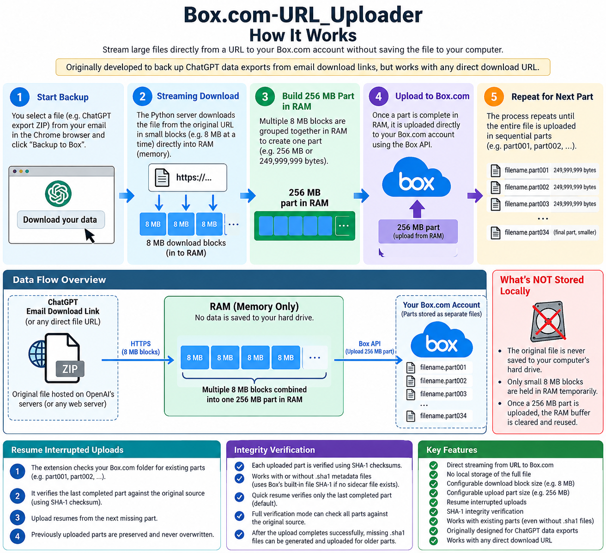

# Box.com-URL_Uploader

Stream a large HTTP(S) download into a **Box.com** account in sequential parts, **without first saving the complete source file to the PC**.

## Original idea

The project began as a way to back up **ChatGPT account exports received by email**. ChatGPT emails a time-limited ZIP download link; the Chrome extension can use the authenticated browser session to retrieve the file in small byte ranges, while the local Python server uploads buffered parts to Box.com. It can also work with other compatible HTTP(S) URLs.

## How the streaming works



```text
ChatGPT export email / another authorised download URL
    |
    v
Chrome extension (authenticated HTTP Range requests)
    | 8 MiB blocks, or configurable fixed/automatic/adaptive sizes
    v
RAM: accumulate a Box-sized part (default 249,999,999 bytes)
    |
    v
Local Python server (127.0.0.1:8765)
    | Box API upload
    v
Box folder: archive.zip.part001, .part002, ...
    |
    +-- clear/reuse RAM buffer; download next part
```

**Important units:** 8 MiB = 8,388,608 bytes. The default Box part is **249,999,999 bytes** (just below 250 MB decimal), *not* 256 MiB. Download request size and upload part size are independent.

The application does not intentionally write the complete original ZIP to a local HDD/SSD. This is **not** a guarantee that the browser, operating system, swap/pagefile, caches or crash dumps never write temporary data.

## Requirements

- Windows and Python 3 (the supplied `Run-Server.bat` starts `server.py`), or another OS running the Python server manually.
- Chrome/Chromium with **Developer mode** and an authenticated session for private source URLs.
- Box.com account, available quota, destination folder and a valid Box API developer token/credentials. Developer tokens expire.
- Working HTTP(S) source URL, preferably supporting Range requests; ChatGPT export links expire.
- Enough RAM for one upload part plus additional network/browser buffers. Keep the browser transfer tab and Python server running.
- Box Free file-size and total-storage limits apply; check your current plan.

## Installation

1. Extract the project.
2. Install Python 3; ensure `python` is on PATH.
3. Start `Run-Server.bat` (Windows), or `python server.py`. The local server normally uses `http://127.0.0.1:8765`.
4. In Chrome, open `chrome://extensions`, enable **Developer mode**, click **Load unpacked**, and select the `extension` directory.
5. Open the extension popup and transfer tab. Set the Box access token and destination folder.
6. Keep the Python server and transfer tab running during the upload. Never expose the local server to the internet.

## Backup a ChatGPT export from an email link

1. Request a ChatGPT data export and wait for the email.
2. Open the signed export link in the Chrome profile containing the extension, while the link remains valid.
3. Explicitly select the original URL and filename. **Capture latest Chrome download** is optional and must not automatically override the chosen source.
4. Verify the displayed source and destination, then select **Start New Backup**.
5. Watch the transfer status. Small download blocks accumulate in RAM and are uploaded as numbered Box files, one part at a time.
6. Preserve all Box parts for restoration; the project does not automatically combine them into one Box file.

**Never publish signed ChatGPT URLs, browser cookies, Box tokens, local server secrets or personal export archives.**

## Resume an interrupted upload

1. Restart the matching Python server and Chrome extension version.
2. Select the **saved backup**, then **Resume Previous Backup**. Do **not** choose another recent Chrome download.
3. The tool examines consecutive numbered files already in the Box folder and their expected sizes.
4. **Quick resume:** read the last complete part's SHA-1 from Box file metadata, re-download that part's original byte range, and compare. Separate `.sha1` sidecars are **not required**.
5. On success, start at the next missing part boundary. If a part was only partially buffered in RAM, download that part again from its start.
6. On a mismatch, stop; do not overwrite an existing part without investigation.

**Caution:** An earlier version could upload the wrong recent Chrome download. Quick resume checks only the last completed part; it does **not** prove that all earlier parts are correct. Use full source verification before relying on a backup affected by this issue.

## SHA-1 metadata and verification

Box supplies SHA-1 in its file metadata. Optional `.sha1` sidecar files may be absent for older uploaded parts and are **not required for resuming**. Once all parts are uploaded and full verification succeeds, missing sidecars are intended to be generated without duplicating existing ones. Comparing a sidecar with Box metadata alone does **not** prove the bytes came from the intended source; source-byte verification is necessary.

## Features and options

| Feature | Description |
| --- | --- |
| Start New Backup | Create a new transfer for an explicitly chosen source. |
| Saved backups / Resume Previous Backup | Restore the selected source and continue after verified Box parts. |
| Capture latest Chrome download | Explicitly choose a recent Chrome download; never silently switch during resume. |
| Fixed / automatic / adaptive download blocks | Configure or automatically adjust HTTP range request size. |
| Upload part size | Set the Box file boundary; keep it unchanged when resuming an existing backup. |
| Inspect archive | Inspect the archive header without extracting its contents. |
| Sample LZMA2 savings | Estimate compression potential from a sample; **not actual recompression of uploaded data**. |
| Quick / full verification | Check the last completed part or all parts against source bytes. |
| Cancel | Stop a transfer, preserving completed Box parts. |

## Restore the original file

Download all numbered Box parts in order and **concatenate their raw binary bytes**; do not extract each part as a ZIP. Verify the reconstructed file's total byte count and full-file digest against the original source when possible.

## Source tree

```text
server.py               Local Python server and Box uploader
Run-Server.bat          Windows launcher
extension/
  manifest.json        Chrome extension manifest
  worker.js            Background service worker
  gmail.js             Email/link helper
  popup.html / popup.js
  transfer.html / transfer.js
docs/images/           Flowchart
```

## Troubleshooting and limitations

- **HTTP 403:** The export URL may have expired, or direct Python requests lack the authenticated browser session.
- **No saved backup:** Chrome extension storage can differ between unpacked extension IDs/installation directories.
- **Box upload rejected:** Check developer token expiry, Box quota and file-size limit.
- **Source mismatch:** Stop and verify affected parts rather than restarting from part 1 or overwriting.
- **No `.sha1` sidecar:** Normal for older uploads; use Box metadata and source verification.
- **Security:** Keep the server bound to loopback; don't commit credentials or export URLs.

**Development status: v0.2.8.** The source has not been independently verified in a complete live Chrome-to-Box recovery test. This is an independent project, not affiliated with OpenAI or Box.
